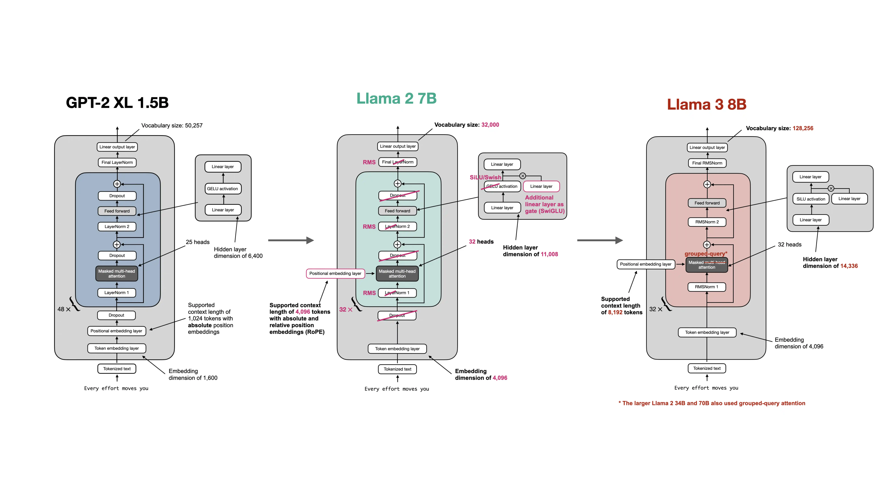

# CLIP 和 Llama 基础

LLaVA 受 InstructGPT、LLaMA 等工作中“用指令微调预训练语言模型”的成功启发，探索用**视觉指令微调大型多模态模型**，取得了很好的效果。模型架构上，LLaVA 追求对已有模型的最简单修改，由两个预训练组件构成：**CLIP 预训练的 ViT 图像编码器**和 **LLaMA/Vicuna 等预训练大语言模型（LLM）**。

LLaVA 的核心思路是使用一个投影模块——LLaVA-1.0 中是一个全连接层，LLaVA-1.5 中改为两层 MLP——将 **ViT 输出的 patch/grid 视觉特征**投影到 LLM 的词嵌入空间，作为 vision tokens 与文本 token 拼接。这一模块可简称为**对齐单元**。训练分为两个阶段：

- **特征对齐预训练**：冻结 ViT 和 LLM 权重，使用**图像-文本对数据集**训练投影/对齐单元。  
- **端到端微调**：冻结 ViT 权重，使用**视觉指令数据集**同时调整对齐单元和 LLM 的权重。

LLaVA-1.5 及后续变体在部分多模态基准上表现亮眼，展示了“简单投影 + 视觉指令微调”将 LLM 扩展到多模态的有效思路；这一路线也被后续 LMM（Large Multimodality Models）研究广泛沿用。注意：LLaVA 使用的是 CLIP 的 **ViT 视觉骨干**，不使用 CLIP 的文本编码器，也不继承 CLIP 的对比预训练目标。

下图展示 Llava-1.5 的架构，考虑到训练成本，我们将以小规模数据去复现一个未完全训练的模型。

为了理解 LLaVA 架构，下面简单介绍 CLIP 和 LLaMA/LLM 的相关信息。如果已经理解 LLaVA 架构，下面的部分可以不看。

## CLIP 双塔模型

[Learning Transferable Visual Models From Natural Language Supervision](https://arxiv.org/abs/2103.00020)

CLIP 是规模化图文对比预训练的代表性工作之一。它把图像和文本映射到同一个嵌入空间，使自然语言可以作为图像分类、检索和匹配的开放词汇接口。**CLIP 的核心是图文对齐和判别式匹配，不是生成式多模态对话模型**，没有 LLM 的指令跟随和文本生成接口。

普通 ViT 预训练后通常接分类头做固定类别分类；CLIP 则用文本编码器把类名/描述编码成零样本分类器，通过图像嵌入与文本嵌入的余弦相似度在候选类上做 softmax。例如把候选类名填入 `A photo of a {label}.`，文本编码器输出文本嵌入，再与图像嵌入匹配，即可实现零样本分类。

CLIP 的核心工作是将图片和文本拉到同一个语义空间，而**没有实现自然语言指令功能**。而后续的很多研究也只是通过架构上或数据上的微调，专精一个方面的自然语言指令，如描述图片场景、回答图片中的问题、判断图片是否有不合理的地方等等的具体问题，没有出现一个自然语言指令引导视觉的通用模型。直到 GPT-4 和 Llava，初步实现了**自然语言指令引导的通用视觉模型**。

### Vision Transformer

ViT 是对于图片的 Transformer Encoder。这是首个证明了 大规模预训练 + Transformer 架构 在计算机视觉领域同样有效的模型，使用一个很简单的思路：**将图片切成大小相等的 patches，经过线性投影得到长度相等的向量，直接 stack 形成输入序列**。同时在最前方加一个 cls token 抽取图片信息，用于适应分类的下游任务。

### CLIP 模型架构

下图展示的是 CLIP 模型架构，其中 Text Encoder 和 Image Encoder 都是用 Transformer 的变种实现的，我们称为**双塔模型**。

#### Text Encoder

使用 GPT-2 改动的 Transformer Decoder。GPT-2 做的主要改动为：
- 使用可学习位置编码，代替正余弦绝对位置编码。
- 删除 encoder-decoder 交叉注意力，一个 Transformer 块中只用因果掩码多头自注意力。
- 增加末尾 LayerNorm。
- 所有归一化层改为 pre-norm，比 post-norm 更加稳定。
- 使用 GELU 激活和 Dropout。

#### Image Encoder

ViT 版本基本沿用 ViT 的 Transformer Encoder，主要改动是：在 patch 嵌入与位置嵌入相加后、进入 Transformer 前额外加一层 LayerNorm，并采用略有不同的初始化。CLIP 也提供 ResNet 图像编码器，包括 RN50、RN101、RN50x4、RN50x16、RN50x64；ResNet 版本使用 ResNet-D 改进、antialiased blur pooling，并用 attention pooling 替代 global average pooling。

### CLIP 预训练

CLIP 的预训练任务是**图文配对判别**的对比学习目标：给定一个 batch 中 N 对（图像，文本），模型要判断哪些图像和哪些文本是真实配对的。

具体流程如下：

1. **数据**：CLIP 构建了 WIT（WebImageText）数据集，约 **4 亿对（图像，文本）**，来自互联网公开来源。  
2. **双塔编码**：图像编码器输出图像特征，文本编码器输出文本特征，两者分别经线性投影映射到共享多模态嵌入空间，并做 L2 归一化。
3. **对比目标**：对一个 batch 的 N 对图文，计算 N×N 的**图像-文本余弦相似度矩阵**，损失是对相似度矩阵**按行和按列分别做交叉熵**后的对称交叉熵：  
   - 图像→文本分类：每张图在 N 个文本中找正确文本；  
   - 文本→图像分类：每段文本在 N 张图中找正确图像；  
   - 两者取平均。  
4. **零样本迁移**：测试时，把目标数据集的类名或描述填入 prompt 模板（如 `A photo of a {label}.`），图像嵌入与所有类文本嵌入计算余弦相似度并 softmax，取最高分。

通过这种图文匹配的预训练，CLIP 摆脱了 categorical label 的限制。可以接受任意的文本输入和任意的图片输入，也达到了很好的 zero-shot 性能。给任何一张照片，都能通过一个句子（自然文本），判断照片中有没有我想要的东西。

总的来说，CLIP 预训练提供的是：**一个可迁移的视觉骨干 + 一个图文共享嵌入空间 + 用自然语言定义分类器的零样本能力**。

### CLIP v.s. LLaVA 

**CLIP 预训练是“双塔图文对比对齐”，LLaVA 是“借用 CLIP 的 ViT 视觉骨干，把视觉 token 投影进 LLM，再用视觉指令微调成多模态助手”**。

| 维度 | CLIP 预训练 | LLaVA |
| --- | --- | --- |
| 模型结构 | 双塔：图像编码器 + 文本编码器 | CLIP ViT 图像编码器 + 投影层 + LLM |
| 预训练目标 | batch 内图文对比/配对判别 | 第一阶段：冻结 ViT 和 LLM，只训练投影层做图文特征对齐；第二阶段：视觉指令微调，训练投影层和 LLM |
| 输出 | 图像/文本嵌入、相似度、零样本分类 | 自然语言回答 |
| 数据 | 4 亿网络图文对 | 图文对 + 视觉指令数据 |
| 能力 | 图文匹配、检索、零样本分类 | 指令跟随、视觉问答、多模态对话 |

## Llama 

Llava 使用的是 Vicuna 模型，Vicuna 本身**是基于 LLaMA 微调出来的对话/指令模型**。Vicuna 对 Llama 架构本身没有做修改，只是**使用 ShareGPT 数据集微调**：ShareGPT 的数据是用户自愿分享的真实 ChatGPT 多轮对话记录，这使得 Vicuna 能够直接学习到高质量、多样化的对话模式，而非仅仅学习语言的一般规律。

Llava-1.5 使用 Vicuna 的后续版本 v1.5，将基座模型从 Llama 切换至 Llama 2，并进一步将上下文长度支持扩展到了 4K 和 16K，以适应更长的对话场景。这里直接介绍 Llama 2 模型架构。

### Llama2 模型架构

Llama2 整体架构上依然是 Transformer Decoder，在具体的层中的算法细节中有做改动。我们基于 **GPT-2 对 Transformer Decoder 架构的主要修改：使用可学习位置编码、删除 encoder-decoder 交叉注意力、增加末尾 LayerNorm、所有归一化层改为 pre-norm、使用 GELU 激活和 Dropout**，简要讲解 Llama2 架构。

下图直观展示了 GPT-2、Llama-2、Llama-3 的架构与差异。图源：`github rasbt/LLMs-from-scratch/ch05/07_gpt_to_llama`

Llama-2 对 GPT-2 的主要改动为：

- RMSNorm 替换所有 LayerNorm，可学习参数更少，计算更简单。
- 线性层使用 SwiGLU 替换原来的 MLP，引入更加复杂的激活函数（门控：随输入变化）。
- 使用 RoPE 位置编码取代 **加性的位置嵌入**，在注意力层通过乘法作用于向量。